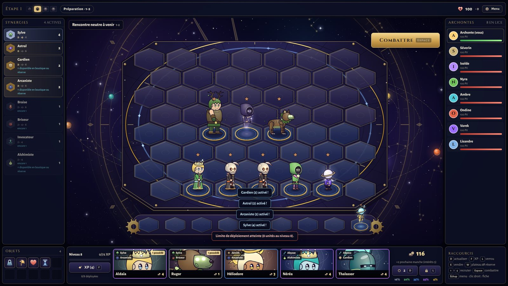
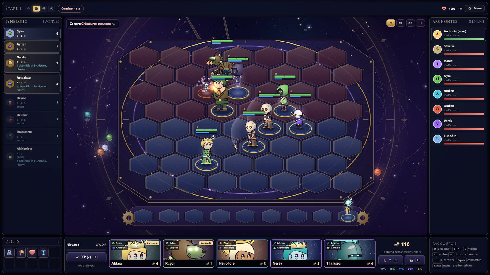
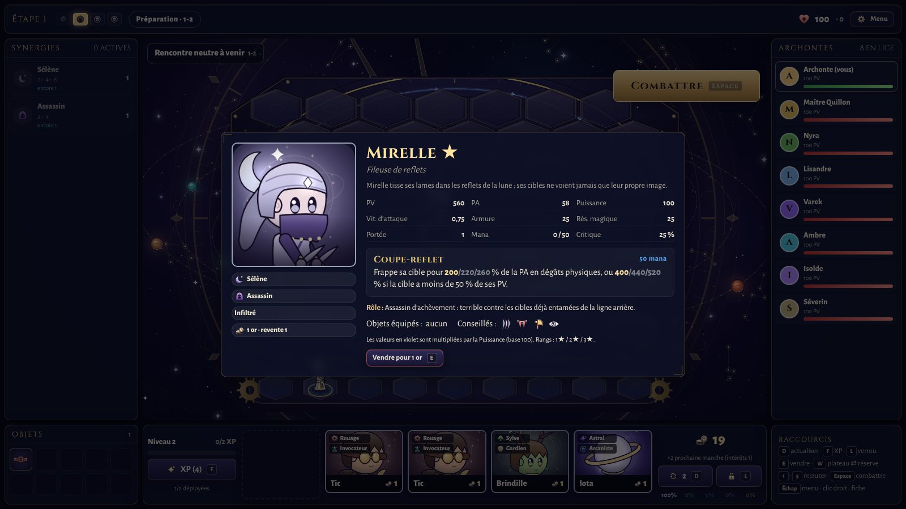
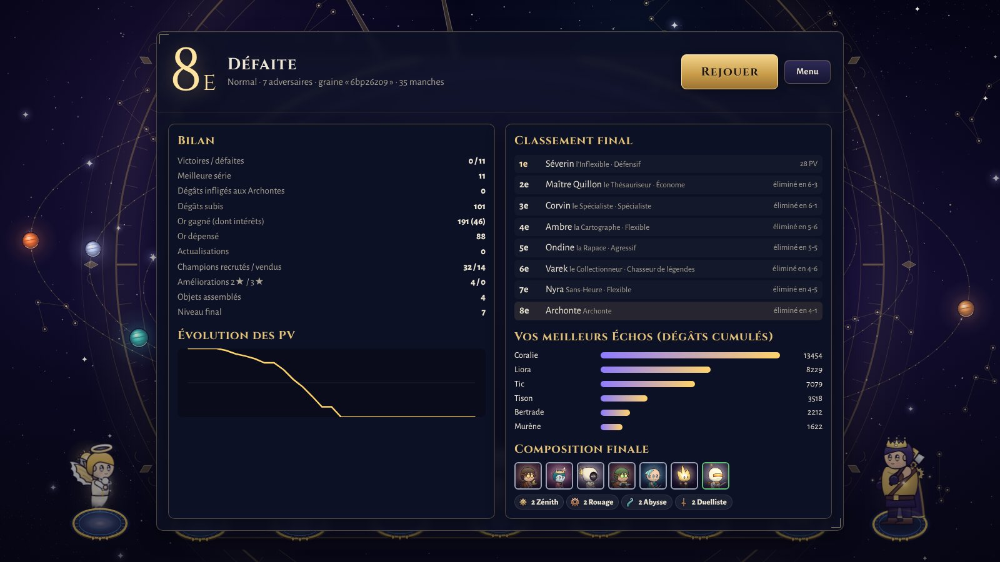

# Orrhéa — Tactiques des Sphères

Auto-battler tactique **solo** : vous affrontez jusqu'à 7 Archontes contrôlés par l'ordinateur.
Recrutez des champions, placez-les sur un plateau hexagonal, combinez synergies et objets ; les
combats se jouent seuls. Le dernier Archonte debout remporte la Convergence.

Univers, personnages, illustrations, musiques et textes sont originaux. Le jeu fonctionne
entièrement hors ligne, dans le navigateur, sans compte ni serveur.

| | |
|---|---|
|  |  |
|  |  |

## Lancer le jeu

Prérequis : [Node.js](https://nodejs.org) 20 ou plus récent (testé avec Node 22).

```bash
cd game
npm install
npm run dev          # version de développement : http://localhost:5173
```

Version optimisée :

```bash
npm run build        # vérification des types + paquet statique dans dist/
npm run preview      # sert dist/ sur http://localhost:4174
```

`dist/` est un site statique autonome (scripts, polices, musiques et effets inclus). N'importe quel
serveur de fichiers statiques convient (`python3 -m http.server -d dist`). L'ouvrir directement
en `file://` ne fonctionne pas : les navigateurs bloquent alors les modules et le chargement de l'audio.

Navigateur : vérifié dans Chromium ; le jeu n'utilise que des API standard (Canvas 2D, Web Audio,
`localStorage`) et vise les navigateurs de bureau récents. Résolution : 1024×768 au minimum,
1280×720 ou plus conseillé.

## Contenu

| | |
|---|---|
| Champions | 60 (13 à 1, 2 et 3 or, 12 à 4 or, 9 à 5 or), une compétence propre chacun — [catalogue](docs/champions.md) |
| Synergies | 18 (8 origines, 10 classes), 2 ou 3 paliers — [catalogue](docs/synergies.md) |
| Objets | 8 composants, 36 objets combinés, 1 consommable — [catalogue et recettes](docs/objets.md) |
| Adversaires | 6 profils stratégiques × 3 difficultés |
| Rencontres neutres | 8 rencontres de créatures, avec butin |
| Musique | 11 morceaux originaux (17 fichiers, couches adaptatives) — [bande-son](docs/audio.md) |
| Effets sonores | 49 effets générés par synthèse |
| Graphismes | figurines, portraits, icônes et décors entièrement procéduraux — [direction artistique](docs/art.md) |

Écrans : menu principal, nouvelle partie (difficulté, nombre d'adversaires, temps de préparation,
graine), continuer, mode entraînement (bac à sable de combats), encyclopédie, règles, paramètres,
crédits, écran de fin avec statistiques détaillées. Un guide « Premiers pas » s'affiche à la
première partie et reste accessible depuis le menu Pause.

## Commandes

| Action | Souris | Clavier |
|---|---|---|
| Recruter | clic sur une carte de la boutique | `1` à `5` |
| Actualiser la boutique (2 or) | bouton ⟳ | `D` |
| Acheter 4 XP (4 or) | bouton XP | `F` |
| Verrouiller la boutique | cadenas | `L` |
| Placer, déplacer, échanger | glisser-déposer | `W` : plateau ⇄ réserve (unité survolée) |
| Vendre | déposer sur la boutique | `E` (unité survolée) |
| Équiper un objet | glisser l'objet sur un champion | |
| Fiche détaillée | clic ou clic droit | |
| Lancer le combat | bouton Combattre | `Espace` |
| Vitesse du combat | ×1 ×2 ×3 | `+` / `-` |
| Pause, fermer une fenêtre | | `Échap` |

## Qualité

```bash
npm test             # 136 tests automatisés (Vitest)
npm run typecheck    # TypeScript strict
npm run validate     # cohérence des données (références, recettes, valeurs, quantités)
npm run qa:browser   # scénario complet dans Chromium (nécessite Playwright et `npm run preview`)
```

Simulations (sans interface, déterministes) :

```bash
npm run sim:smoke                    # 300 combats aléatoires : erreurs, durées, nuls
npm run sim:game                     # une partie complète à 8 IA
npm run sim:balance -- 100 normal    # parties complètes → reports/balance-*.json/csv
npm run sim:units -- 6000 2          # puissance des champions à coût égal → reports/unitpower-*.json
npm run sim:traits -- 300            # valeur propre des synergies → reports/traitpower.json
npm run sim:difficulty -- 32         # lobbies mixtes Facile / Normal / Difficile → reports/difficulty.json
npm run sim:trace -- econome        # suivi manche par manche d'un profil d'IA (or, niveau, PV)
npm run docs                         # régénère les catalogues docs/*.md depuis les données
npm run audio                        # régénère musiques et effets (public/audio ; nécessite ffmpeg)
```

Résultats et décisions : [docs/equilibrage.md](docs/equilibrage.md) · tests et vérifications :
[docs/qualite.md](docs/qualite.md).

## Documentation

- [Conception et architecture](docs/conception.md) — règles, systèmes, moteur de combat, IA, code
- [Champions](docs/champions.md) · [Synergies](docs/synergies.md) · [Objets](docs/objets.md) — générés depuis les données
- [Équilibrage](docs/equilibrage.md) — méthodes, résultats de simulation, décisions
- [Qualité](docs/qualite.md) — tests, simulations, vérifications dans le navigateur
- [Direction artistique](docs/art.md) · [Bande-son](docs/audio.md)
- [Limites et feuille de route](docs/limites-et-feuille-de-route.md)

## Structure

```
src/
  config/        toutes les valeurs de règles (économie, niveaux, boutique, combat, manches)
  core/          RNG à graine, définitions, accès au contenu, validation
  board/         grille hexagonale
  combat/        simulation déterministe à pas fixe, DSL des compétences, ciblage, statuts
  champions/ traits/ items/ creatures/    contenu déclaratif
  shop/ economy/ progression/ game/       boutique et pool partagé, revenus, niveaux, étoiles, manches
  ai/            profils, difficultés, évaluation, placement par simulation
  save/          sauvegarde locale versionnée et validée
  render/        rendu Canvas 2D : plateau, figurines, effets, portraits, icônes
  audio/         gestionnaire Web Audio (couches adaptatives, volumes séparés)
  app/           contrôleur de l'application, boucle d'animation
  ui/            interface React
tools/           simulations, génération audio, documentation, validation
tests/           tests Vitest
public/audio/    musiques et effets générés (MP3) et manifeste
reports/         résultats exportés des simulations
```

## Licences des éléments tiers

- React et React DOM : MIT
- Polices Cinzel et Alegreya Sans (paquets `@fontsource`) : SIL Open Font License 1.1
- Outils de développement (Vite, TypeScript, Vitest, tsx) : non inclus dans le jeu livré

Musiques, effets sonores, graphismes, textes et données de jeu ont été créés pour ce projet.
